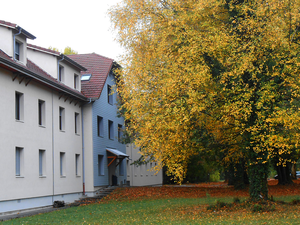

# INFO002 - TP2 : stéganographie, signature, diplôme
- L'utilisation de l'ia a été utilisée pour les recherches d'optimisation et de solutions techniques. 
- 
## Installation et utilisation
    python3 -m venv venv && . venv/bin/activate
    pip install Pillow pycryptodome "qrcode[pil]" bottle
    python3 diplome.py keygen # pour générer les clés
    python3 test_tp2.py # test stego et signature
    python3 diplome.py generer "Alice Martin" 15.2 images/diplome-BG.png -o diplome.png       
    python3 diplome.py extraire diplome.png
    python3 diplome.py verifier diplome.png
    python3 serveur.py  #serveur web pour verifier les diplômes
    python3 registre.py liste  #liste des diplômes délivrés
    python3 registre.py revoquer <code>

## Architecture
- `stego.py` : fonctions de stéganographie (cacher / extraire
- `signature.py` : fonctions de signature (signer / verifier)
- `diplome.py` : programme principal (génération / extraction / vérification)

## Choix techniques
- Stéganographie : LSB du canal rouge, 1 bit/pixel, en-tête de 4 octets = taille du message. PNG obligatoire (sans perte) n'est vraiment pas la meilleure solution, proposée une librairie plus pertiente.
- Signature : RSA 3072 bits, PSS, SHA-256 (PyCryptodome). On signe l'empreinte de {nom, moyenne, date}.
- Caché dans l'image : les données signées + la signature (base64). Visible : nom et moyenne.
- Ordre : texte dessiné AVANT la stégano, sinon les LSB seraient écrasés.

## Vérification
`python3 diplome.py verifier diplome.png` extrait les données cachées, vérifie la signature avec cle_publique.pem,
puis l'utilisateur compare le contenu signé avec le texte visible.

## Détails des questions 

### 1 Steganographie
- Image de base : `images/chablais-orig.png`
- Image de sortie : `images/resultats/out.png`
- Message caché : `b"Lorem ipsum"` (11 octets)

| Image originale | Image avec message caché |
|---|---|
|  |  |

Les deux premières images sont identiques à l'œil nu : seul le bit de poids faible du rouge change
(écart de couleur d'au plus 1/255). Le message occupe 88 bits, soit les 88 premiers pixels de la
première ligne, d'où une zone modifiée minuscule sur la troisième image.

#### Limites du LSB et meilleure solution
Notre méthode (LSB séquentiel sur le rouge) est simple mais faible :
- les modifications sont regroupées en haut de l'image et deviennent visibles sur les zones unies ;
- elle est détectable par analyse statistique (test du χ², RS analysis), car remplacer le dernier bit
  égalise les occurrences des valeurs paires et impaires ;
- n'importe qui connaissant la méthode peut extraire le message ;
- elle ne résiste à aucune recompression (JPEG, redimensionnement, capture d'écran).

Pour le diplôme, c'est l'**authenticité** qui compte, pas la confidentialité : les points 1 et 3
apportent donc plus que le point 4. Et comme aucune variante LSB ne résiste à la recompression, il
faut doubler le dispositif par une information visible (QR-code) pour les diplômes imprimés ou capturés.

Au niveau des solutions existantes, j'ai pu répertorier les standards suivants :

| Besoin | Solution | Pourquoi |
| --- | --- | --- |
| Diplôme signé, vérifiable | **W3C Verifiable Credentials / Open Badges 3.0** | Standards conçus pour les diplômes numériques ; signature, clé publique et format de vérification définis. |
| Document imprimable | **PDF signé (PAdES)** | Signature de PDF reconnue juridiquement en Europe (eIDAS). |
| Provenance d'une image | **C2PA (Content Credentials)** | Signature de provenance intégrée aux métadonnées de l'image. Elle disparaît si on retire les métadonnées. |
| Contrôle par un tiers | **QR-code + page de validation** | Survit à l'impression et à la capture d'écran, contrairement au LSB. |
| Date de délivrance certifiée | **Horodatage RFC 3161** | Un tiers de confiance prouve que le diplôme existait à cette date. |
| Marquage caché | **Stéganographie adaptative** (HUGO, WOW, S-UNIWARD, J-UNIWARD, F5) | Modifie surtout les zones texturées ; résultats de recherche, pas des bibliothèques prêtes pour la production. |

## 2. Signature de données

### Question 1 : création de la paire de clés
- Fonction : `generer_cles()` dans `signature.py` (bibliothèque PyCryptodome).
- Clés fournies dans l'archive : `cle_privee.pem` et `cle_publique.pem`.
- Algorithme : RSA 3072 bits. Il offre environ 128 bits de sécurité, ce qui est le niveau actuellement recommandé.
- La clé privée peut être protégée par une passphrase (chiffrement scrypt + AES-128), et seule la clé
  publique est distribuée.

### Question 2 : signer des données
- Fonction : `signer(data, chemin_cle_privee, passphrase)`.
- On ne signe pas les données directement mais leur empreinte SHA-256 : c'est plus rapide, et la
  taille de la signature ne dépend pas de celle des données.
- Padding : PSS (probabiliste), recommandé à la place de PKCS#1 v1.5. Deux signatures des mêmes
  données sont différentes, et PSS dispose d'une preuve de sécurité.

### Question 3 : vérifier une signature
- Fonction : `verifier(data, signature, chemin_cle_publique)`, qui renvoie `True` ou `False`.
- Tout le monde peut vérifier avec la clé publique, sans connaître la clé privée.

### Justification des choix
- RSA-PSS + SHA-256 : standards éprouvés, disponibles dans PyCryptodome.
- Alternative envisagée : ECDSA / Ed25519, qui donnent des signatures bien plus courtes (utile pour un
  QR-code), mais RSA est plus répandu et plus simple à expliquer.
- Limite : la clé privée est ici un simple fichier. En production, elle serait dans un HSM.
